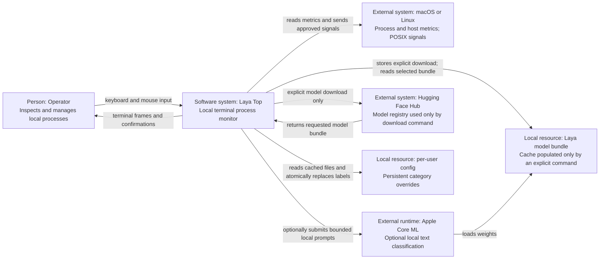
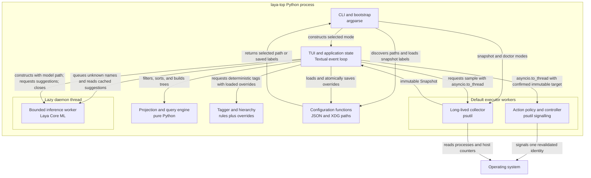

# Laya Top architecture

| Field | Value |
| --- | --- |
| Status | Living architecture document |
| Last reviewed | 2026-09-24 |
| Project version | 0.1.0 |
| Audience | Contributors, reviewers, packagers, and security auditors |
| Supported runtime | Python 3.11–3.13; macOS and Linux design target |
| Authoritative scope | Runtime structure, invariants, performance, safety, features, and evolution |

This document describes the architecture that exists in the repository. It also records the
constraints behind it, the measured optimizations, and the conditions that would justify a
larger change such as a native collector or Rust rewrite. The shorter design and performance
notes remain useful history, but this is the primary technical reference.

## 1. Goals and boundaries

Laya Top is a local terminal process monitor. It helps a person answer four questions:

1. What is using the machine's CPU and memory?
2. Which application and software category does each process belong to?
3. Why did the tool choose that category?
4. Can the selected process be safely signalled by the current user?

The application combines `psutil` process sampling, a Textual terminal interface,
deterministic tagging, and optional local Laya Core ML inference. It is deliberately not a
daemon, remote administration service, automatic cleanup agent, or privileged power monitor.

The architecture follows these principles:

- **Local first.** Monitoring, rules, model inference, and saved labels run on the host.
- **Safe by construction.** Classification never grants control; process actions have a
  separate policy boundary and revalidate identity immediately before signalling.
- **Responsive under load.** Blocking OS reads and inference stay off the UI event loop.
- **Stable identity.** A process is identified by PID and creation time, never PID alone.
- **Explainable results.** Every tag records whether it came from the user, a rule, Laya, or
  an unknown fallback.
- **Graceful degradation.** Missing permissions, a missing model, or inconclusive inference
  reduces detail without stopping the monitor.
- **Measurement before migration.** Performance work starts with profiles and budgets; a
  native rewrite requires an end-to-end benefit large enough to repay its release burden.

## 2. Feature map

| Capability | Current behavior | Primary implementation |
| --- | --- | --- |
| Host monitoring | CPU, memory, swap, uptime, network and disk rates; 60-sample histories | [`collector.py`](src/laya_top/collector.py), [`widgets.py`](src/laya_top/widgets.py) |
| Process monitoring | CPU, RSS, owner, state, parent, age, threads, executable | [`collector.py`](src/laya_top/collector.py) |
| Process views | Flat table, parent-child tree, category/subcategory totals and drill-down | [`app.py`](src/laya_top/app.py), [`query.py`](src/laya_top/query.py) |
| Discovery | Sorting, compound search, exclusion, numeric filters, pins | [`query.py`](src/laya_top/query.py), [`app.py`](src/laya_top/app.py) |
| Classification | User override, deterministic rule, optional Laya suggestion, unknown fallback | [`tagging.py`](src/laya_top/tagging.py), [`intelligence.py`](src/laya_top/intelligence.py) |
| Categories | Stable broad category plus deterministic subcategory | [`tagging.py`](src/laya_top/tagging.py) |
| Inspection | Details dialog with identity, provenance, owner, path, parent and resources | [`screens.py`](src/laya_top/screens.py) |
| Process control | Confirmed terminate, kill, pause and resume for eligible processes | [`actions.py`](src/laya_top/actions.py), [`screens.py`](src/laya_top/screens.py) |
| Headless use | Bounded JSON snapshot, diagnostics and model management | [`cli.py`](src/laya_top/cli.py) |
| Responsive terminal | Adaptive columns, collapsed panels, scrollable details | [`layout.py`](src/laya_top/layout.py), [`app.tcss`](src/laya_top/app.tcss) |
| Demonstration | Deterministic sample data with real actions disabled | [`collector.py`](src/laya_top/collector.py) |

## 3. System context

The context diagram is C4-inspired: it keeps the person and software systems at the context
level, and also shows local file resources because their privacy and lifecycle are part of the
product boundary. Every relationship is directional and labelled by purpose.



**Legend:** rectangles name the element type, responsibility, and boundary role; arrows are
unidirectional data or control flows. There is no network relationship during monitoring or
inference. The separate `laya-top model download` command is the only built-in path that
retrieves model weights. JSON snapshots are emitted on stdout; the invoking shell or user
chooses whether to save them.

## 4. Runtime containers and execution contexts

Laya Top ships as one Python application. The boxes below are logical components and
execution contexts, not separately deployed services.



**Legend:** the outer box is one operating-system process; inner boxes are logical components,
while nested subgraphs name separate execution contexts. Arrows show calls or returned
data, not deployment links.

### Dependency direction

| Layer | May depend on | Must remain independent from |
| --- | --- | --- |
| Domain models | Python standard library | Textual, psutil, Core ML, filesystem |
| Collector | Domain models, psutil | TUI widgets, model inference, process actions |
| Query and tagging | Domain models and standard library; tagging receives an override mapping | Config storage, intelligence, terminal rendering and signalling policy |
| Intelligence | Local model adapter, bounded worker primitives | TUI and action controller |
| Action controller | Domain identity and psutil | Tags, probabilities, row positions |
| TUI | All application services through their public methods | Direct Core ML execution or raw signal syscalls |
| CLI/config | Service construction, paths, JSON | TUI internals |

This direction keeps monitoring usable without the model, makes the domain logic testable
without a terminal, and prevents a category result from becoming an authorization signal.

## 5. Domain model and invariants

[`models.py`](src/laya_top/models.py) defines frozen dataclasses shared by the collector,
query engine, UI, and action controller.

### Identity

`Identity(pid, created)` is the canonical process identity. `created` is the operating system's
creation timestamp. The pair protects three operations from PID reuse:

- CPU deltas cannot leak from an exited process to a new process with the same PID.
- UI selection follows a process while rows move, rather than following a row number.
- A confirmed action cannot silently target a replacement process.

The identity pair is serialized into a cached string key, which is also the Textual `DataTable`
row key.

### Process

`Process` is an immutable observation containing identity, parent, display metadata, CPU,
resident memory, state, and thread count. A denied executable or owner lookup receives a
field-level fallback. A denial or race in other required fields skips that process for the
sample without failing the whole snapshot.

Process names, executable paths, and user names come from an untrusted and changing OS view.
The collector removes terminal control characters and applies field-specific length bounds
before those strings reach the TUI, model prompt, or JSON serializer.

### Snapshot

`Snapshot` is an immutable point-in-time value containing host totals, transfer rates, and a
tuple of processes. Each successful refresh replaces the displayed snapshot as a unit. The UI
does not observe a partially updated collector state.

### Tag

A tag combines a stable broad category, a narrower subcategory, source, confidence where
applicable, and a human-readable reason. The rendered label is derived once and cached.

## 6. Refresh pipeline

```mermaid
sequenceDiagram
    actor Person
    participant UI as Textual event loop
    participant Worker as executor worker
    participant Collector as Collector
    participant Tagger as Tagger
    participant Model as inference daemon
    participant Table as keyed DataTable

    Person->>UI: input, resize, or selection
    UI->>UI: update interaction state immediately
    UI->>Worker: asyncio.to_thread(collector.sample)
    Note over UI: _sampling prevents overlapping refreshes
    Worker->>Collector: sample host and process counters
    Collector-->>Worker: immutable Snapshot
    Worker-->>UI: completed result
    loop all sampled processes
        UI->>Tagger: classify cached process metadata
        alt user override or deterministic rule
            Tagger-->>UI: final tag
        else unknown software
            Tagger-->>UI: deterministic unknown tag
            UI->>Model: request suggestion
            alt result is already cached
                Model-->>UI: suggested or inconclusive tag
            else cache miss
                Model-->>UI: enqueue work and return no suggestion
            end
        end
    end
    UI->>UI: filter, group, sort, and calculate layout
    UI->>Table: remove vanished rows; add new rows
    UI->>Table: update changed cells; reorder only if needed
    Table-->>Person: retained terminal frame
```

**Legend:** solid arrows are synchronous calls unless labelled as queueing; dashed arrows are
return values. The inference result is observed on a later refresh after a cache miss.

The default refresh interval is two seconds and is configurable from 0.5 to 30 seconds.
Freezing stops collection while leaving navigation, details, and responsive layout active.
Tagging and optional inference run over every sampled process before search and ownership
filters are applied. This keeps later tag filters and category groups complete, while the
bounded inference queue and rate limit control the extra work.

## 7. Collection architecture

The collector is intentionally long-lived. Recreating it every refresh would lose CPU
baselines and the metadata caches that make process-heavy machines inexpensive to sample.

### Sampling strategy

- `psutil.process_iter()` supplies reusable `Process` handles and avoids a separate PID-list
  race.
- `Process.oneshot()` batches fields that psutil can serve from the same underlying OS read.
- CPU time and RSS are sampled every tick because they drive the live display.
- Static identity metadata such as parent, name, executable, user and UID is cached for 60
  seconds.
- Process state is cached for five seconds.
- Cache entries are keyed by `(PID, creation time)` and removed after process exit.
- Process disappearance, access denial, and zombie races are handled per process. One race
  cannot discard the rest of the snapshot.

### Process CPU calculation

For an identity `i`, the displayed CPU percentage is calculated from consecutive process CPU
times and wall-clock sample times:

```text
cpu_percent(i) = 100 * (process_cpu_now(i) - process_cpu_previous(i))
                       / (sample_time_now - sample_time_previous)
```

One fully occupied logical core is 100%. A multithreaded process can exceed 100%. The first
sample creates the baseline and therefore reports no interval usage. Non-positive deltas are
discarded rather than displayed as false activity.

### Host counters

Host CPU, memory, swap, disk, network, and uptime are sampled independently of the process
table. Disk and network values are interval rates derived from cumulative counters. CPU and
memory histories hold the most recent 60 values in memory and use fixed percentage scales so
a low but steady series does not appear fully saturated.

### Known measurement limits

- RSS includes shared pages, so sums by category are informative rather than unique physical
  allocation.
- Protected and very short-lived processes may have incomplete metadata or disappear between
  calls.
- psutil does not expose the per-process GPU, ANE, power, or network values that asitop-style
  privileged tools can collect.

## 8. Classification architecture

Classification never changes what the collector samples or whether a process is eligible for
an action. It does affect explicit tag/source search filters, category grouping, and the text
shown to the user.

### Resolution order

1. **User override.** An exact executable path is preferred as the key; process name is the
   fallback when the OS withholds the path.
2. **Deterministic rule.** Compiled expressions match executable names, application bundles,
   and known system locations.
3. **Laya suggestion.** Optional local inference assigns only a broad category for software
   that the rules do not recognize.
4. **Unknown fallback.** Missing, disabled, overloaded, or inconclusive inference stays
   explicitly unknown.

The stable broad categories are AI, Development, Browser, Communication, Media, System, and
Other. Deterministic rules add subcategories such as Inference, Editor, Runtime, Database,
Renderer, Chat, Audio, Desktop, and Virtual machine. A Laya broad result receives a
deterministic subcategory from its name; the application does not spend a second model call
on hierarchy.

### Inference isolation

[`intelligence.py`](src/laya_top/intelligence.py) owns one lazy daemon worker. It is not
started until an unknown process needs classification. The boundary has these controls:

- a queue limited to 64 pending items;
- a pending set that coalesces duplicate requests;
- no more than two new classifications per second;
- a 512-entry in-memory LRU result cache;
- local-files-only model loading;
- model prompts restricted to a shortened process name and application name;
- prompt length checked with the loaded model's actual tokenizer and reported maximum (96
  tokens for the current bundle), with the candidate shortened until it fits;
- no command-line arguments, environment variables, user names, full paths, file contents,
  or network activity in prompts;
- calibration temperatures clamped to the conservative range 0.5–5 before prediction;
- probability validation for finite values in `[0, 1]`;
- display acceptance only when the top score is at least 0.70 and leads the runner-up by at
  least 0.15; the model's Other choice remains inconclusive.

The thresholds are conservative display heuristics, not measured accuracy claims. A confident
model can still be wrong, so each suggestion is visibly marked and can be overridden.

### Model trust boundary

The current downloader selects the default revision of a Hugging Face model repository. Laya
Top does not yet pin an immutable revision or verify an application-owned checksum/manifest,
and it does not impose a disk quota. Release hardening should pin a reviewed commit, verify a
versioned artifact manifest before first load, and distinguish complete bundles from partial
downloads.

The current output check validates the selected label, probability count, finite range, and
acceptance thresholds. It does not yet require the probability keys to exactly match the known
schema, require their sum to be normalized, or prove that the selected label is the argmax.
Those conditions belong in the backend contract and adversarial unit tests before model output
is treated as more than a suggestion.

### Backpressure and failure behavior

The UI never waits for a model prediction. A cache miss queues work and returns Unknown for
the current frame; a later refresh sees the cached result. When the queue is full, the request
is skipped rather than allowing unbounded memory or latency. Load and prediction errors update
diagnostic state and leave deterministic monitoring available.

## 9. Query and projection engine

[`query.py`](src/laya_top/query.py) converts an immutable snapshot and UI state into the rows
to display. It does not mutate collector data.

- Blank search takes a fast path and does not construct searchable metadata.
- Parsed queries are stored in a bounded 128-entry LRU cache.
- Terms combine with AND; leading `-` negates; quoted text preserves spaces.
- Structured filters cover tag, subcategory, application, user, state, source and PID.
- CPU and memory comparisons use typed numeric values rather than formatted cell strings.
- Tree traversal is iterative and cycle-safe because malformed parent relationships are
  possible in live operating-system data.
- Sorting uses deterministic tie-breakers so equal resource values do not cause row jitter.
- Pins are a presentation priority layered over the selected sort, not a separate copy of a
  process.

Category mode groups by the complete `Category / Subcategory` label and calculates aggregate
CPU and RSS from the current snapshot. Opening a group returns to process rows with the
matching tag filter.

## 10. TUI architecture and responsive layout

Textual owns all widget mutation on its event-loop thread. `asyncio.to_thread()` performs the
blocking sample, then returns the completed snapshot before the UI touches any widget. The
inference thread also never calls a widget; it communicates through bounded in-memory state
that is read on a future refresh.

### Retained table updates

Process and tree rows are reconciled by identity:

1. Calculate the desired ordered identity list.
2. Remove keys that no longer exist.
3. Add keys that appeared.
4. Compare lightweight presentation signatures for existing keys.
5. Allocate Rich `Text` and update only cells whose displayed value changed.
6. Ask the table to reorder only when the identity order changed.

This avoids clearing and rebuilding every process row. It also keeps the selected process
stable when CPU changes reorder the table. Category mode has fewer aggregate rows and
currently rebuilds them on each render.

If a selected identity exits, the next process/tree reconciliation clears the table selection.
An already open confirmation deliberately retains the immutable original target; confirmation
still reaches the action controller, which rejects the stale identity before signalling.

### Layout policy

[`layout.py`](src/laya_top/layout.py) derives visible columns from actual table viewport width,
not only the outer terminal size. Resize events recalculate column visibility even while the
snapshot is frozen.

| Condition | Layout response |
| --- | --- |
| Width at least 145 columns | Full table plus side inspector |
| Width below 145 | Compact composition |
| Width below 85 | Narrow composition and fewer secondary columns |
| Width below 65 | Slim composition with core process fields |
| Height below 30 rows | Short composition; graph space is reduced |
| Height below 20 rows | Flat composition focused on the table |

At 80×24 the core table fits without horizontal scrolling. Process names consume the flexible
remainder after fixed-width numeric columns. Details that do not fit remain available in the
scrollable Enter dialog, so responsive hiding does not destroy access to information.

### Interaction model

Keyboard actions, buttons, and supported column headings dispatch the same application
methods. Modals are used for details, category membership, help, labels, action history, and
signal confirmation. Destructive confirmations focus Cancel initially; force kill additionally
requires the PID to be typed. Styling uses semantic text in addition to color, and Textual's
output respects the `NO_COLOR` environment convention.

## 11. Process-control security boundary

The action controller treats terminal selection and tag results as untrusted input. Its only
authority comes from a freshly validated immutable identity and the current operating-system
user.

### Trust boundaries

| Input | Trust level | Required handling |
| --- | --- | --- |
| Selected row | Stale presentation state | Resolve to captured `(PID, creation time)` |
| Category or Laya result | Descriptive, never authoritative | Do not consult for action eligibility |
| PID typed for force kill | Confirmation evidence only | Still perform every controller check |
| Process metadata in snapshot | Potentially stale | Reopen and re-read immediately before signal |
| Current UID and ancestor chain | OS policy inputs | Fail closed when ownership or ancestry is unreadable |

### Action sequence

```mermaid
sequenceDiagram
    actor Person
    participant UI as Confirmation dialog
    participant Controller as Action controller
    participant OS as Operating system

    Person->>UI: request terminate, kill, pause, or resume
    UI->>UI: show action, process name, PID, and risk
    Person->>UI: explicitly confirm
    UI->>Controller: action plus immutable identity
    Controller->>Controller: validate allowed action and protection policy
    Controller->>OS: reopen PID and read creation time, UID, and name
    OS-->>Controller: current process metadata
    Controller->>Controller: compare identity; verify ownership and protections
    alt every check passes
        Controller->>OS: send one requested signal through psutil
        OS-->>Controller: result or OS error
    else any check fails
        Controller-->>UI: deny without sending a signal
    end
    Controller-->>UI: bounded history entry and user-visible result
```

**Legend:** the controller is the enforcement boundary. Every alternative that does not reach
the explicit signal arrow returns without changing the target process.

### Safety invariants

- PID 0, PID 1, Laya Top, and Laya Top's ancestor chain are protected.
- Critical session process names are protected as a second defensive check.
- Only processes owned by the real current user are eligible; running Laya Top with `sudo`
  does not turn it into a general root process manager.
- UID 0 targets are always denied. If Laya Top itself runs as UID 0, no target can satisfy both
  the same-owner and non-root requirements, so actions are effectively disabled.
- An unreadable ancestor chain or ownership check fails closed.
- Only the four allow-listed actions are accepted.
- No action uses a shell, invokes `sudo`, recurses into children, or signals a process group.
- SIGTERM is not automatically escalated. SIGKILL requires a separate confirmation.
- Every action rechecks creation time and ownership immediately before calling psutil.
- Demo mode disables real actions.

Action history is bounded and memory-only. It supports review during the session without
creating a persistent activity log containing process names.

## 12. Concurrency and lifecycle

| Context | Responsibility | Coordination |
| --- | --- | --- |
| Main event loop | Input, layout, state transitions, widget mutation | Sole owner of Textual UI state |
| Executor worker | One collector sample or process action | Awaited with `asyncio.to_thread`; no overlapping samples |
| Inference daemon | Model load and bounded classification work | Queue, pending set, LRU cache, cooperative stop event |

The `_sampling` guard prevents timer ticks from creating a backlog when collection takes longer
than the selected interval. A failed sample reports an error but does not replace the last good
snapshot. Textual owns timer and application-worker shutdown; the app's unmount hook requests
model-worker termination. The model thread is a daemon so it cannot keep the Python process
alive indefinitely.

The stop event is cooperative between predictions. It does not interrupt or join a model load
already in progress. The daemon flag prevents that thread from delaying interpreter exit; a
future non-daemon worker design would need cancellable initialization or a supervised
subprocess.

Thread workers must not mutate Textual widgets directly. This matches Textual's worker model,
which keeps UI changes on the main thread, and Python's intended `asyncio.to_thread()` use for
blocking I/O.

## 13. Persistence and filesystem layout

Laya Top follows the XDG base-directory convention and uses user-home fallbacks when the
variables are unset.

| Data | Preferred location | Lifetime and handling |
| --- | --- | --- |
| Category overrides | `$XDG_CONFIG_HOME/laya-top/labels.json` | Persistent user configuration; values validated; temporary file then `os.replace()` |
| Model bundle | `$XDG_CACHE_HOME/laya-top/model` | Re-creatable local cache; downloaded only by command |
| Model override | `--model` or `LAYA_TOP_MODEL` | Explicit runtime selection; not copied |
| Action history | Memory | Bounded to the current session |
| AI result cache | Memory | Bounded LRU; rebuilt after restart |
| JSON snapshot | User-selected stdout/file | Explicit export; may contain owner names and executable paths |

Model discovery is deterministic: command-line path, environment path, XDG cache, local
`models/snake`, then an adjacent `laya-coreml/models/snake` checkout. Monitoring never triggers
a download.

Atomic replacement prevents readers from seeing a partially written label file. It does not
claim power-loss durability because the application does not fsync the file and containing
directory. The read-modify-replace sequence also has no inter-process lock; two Laya Top
instances saving labels concurrently can overwrite one another's most recent change.

## 14. CLI and operating modes

[`cli.py`](src/laya_top/cli.py) is the installed `laya-top` entry point.

| Mode | Terminal required | Model behavior | Process actions |
| --- | --- | --- | --- |
| Live TUI | Yes | Optional, lazy, local | Enabled by policy and confirmation |
| `--no-ai` live TUI | Yes | Never loaded | Enabled by policy and confirmation |
| `--demo` | Yes | Deterministic sample labels | Disabled |
| `snapshot` | No | Rules and saved labels only | Not exposed |
| `doctor` | No | Reports availability; inference only with `--check-model` | Not exposed |
| `model path` | No | Resolves selected/default directory | Not exposed |
| `model download` | No | Explicit network download | Not exposed |

The live mode rejects a missing TTY with a clear error instead of emitting terminal control
codes into a pipe. Snapshot output is machine-readable JSON and bounds the returned process
count.

## 15. Performance architecture

The hot path is a pipeline, so optimization is measured end to end: OS collection, tagging,
query projection, presentation allocation, and terminal reconciliation.

### Budgets

[`scripts/benchmark_refresh.py`](scripts/benchmark_refresh.py) measures an optional live
collector and a synthetic unchanged render. The target load is approximately 1,000 processes
or rows:

| Metric | Workload | Budget |
| --- | --- | --- |
| Warm collector p95 | Current host process set; compare runs at similar counts | Below 100 ms near 1,000 processes |
| Unchanged table refresh p95 | Synthetic process rows; 1,000 by default | Below 25 ms |

These thresholds catch regressions; they are not universal latency guarantees. Kernel load,
process permissions, terminal implementation, and virtualization affect real measurements.
The script currently emits timing JSON and does not fail its process when a budget is missed;
CI enforcement remains an evolution item.

Two behavioral hot-path invariants complement the timing measurements: unchanged process/tree
rows perform no clear, cell update, or sort; and one started/exited process adds/removes only
its corresponding row. Headless UI tests verify both. The architecture also avoids loading the
Core ML backend when AI is disabled or deterministic rules cover every sampled process.

### Optimizations already implemented

| Area | Optimization | Effect |
| --- | --- | --- |
| OS reads | Reuse `process_iter()` handles and `oneshot()` grouped reads | Fewer process objects and repeated kernel reads |
| Cadence | Separate fast counters from 5-second state and 60-second static metadata | Expensive paths and user lookups leave the per-tick path |
| Identity | Key CPU baselines, caches, rows and selection by PID plus creation time | Correct reuse handling and stable UI state |
| Classification | Precompiled rules, cached app names and labels | Avoid repeated path parsing and rendering work |
| Model | Lazy load, bounded queue, duplicate coalescing, rate limit and bounded LRU | Keeps inference outside latency and memory critical paths |
| Search | Bounded compiled-query cache and blank-query fast path | Avoid repeated parsing and metadata concatenation |
| Rendering | Presentation signatures before Rich `Text` allocation | Unchanged rows stay allocation-light |
| Reconciliation | Add/remove process churn individually and reorder only when required | No whole-table rebuild for routine starts, exits, or stable frames |
| Layout | Recompute only from viewport and size changes | Responsive behavior without per-cell layout work |

### Reference measurements

The latest documented Apple Silicon development measurements are:

- warm collection across 881 live processes: 17.3 ms median, 18.5 ms p95;
- cold collection: approximately 117 ms;
- unchanged 1,000-row render: 3.6 ms median, 6.8 ms p95;
- unchanged 960-row presentation path after signature optimization: 21.6 ms to 6.9 ms;
- process-churn reconciliation: 159.2 ms to 74.7 ms;
- aggressive rules-only TUI run: approximately 60 MiB RSS.

The commands and interpretation are recorded in [`docs/PERFORMANCE.md`](docs/PERFORMANCE.md)
and [`docs/VALIDATION.md`](docs/VALIDATION.md). Measurements describe one machine and should
be compared by running the same benchmark before and after a change.

## 16. Native and Rust decision

A Rust rewrite is not currently supported by the profile. psutil already performs much of its
kernel interaction in native code, while the measured bottlenecks were metadata cadence and
Python presentation allocation. Both were reduced without replacing the tested interaction,
Core ML, and safety layers.

Native work becomes reasonable when a supported platform repeatedly misses the budgets, or
when a single self-contained binary becomes a product requirement. The preferred sequence is:

1. Add physical Linux validation and record collection, idle CPU, RSS, cold-start, and render
   measurements with the existing benchmark.
2. Preserve the immutable `Snapshot` boundary and prototype only a `sysinfo` collector.
3. Expose the prototype to Python with PyO3/maturin and ship fallback Python collection until
   macOS ARM64/x86_64 and Linux glibc/musl wheels are covered.
4. Compare end-to-end behavior, binary or wheel size, packaging maintenance, permissions, and
   error quality—not only a collection microbenchmark.
5. Consider Ratatui for a full rewrite only if replacing Textual and the Python Core ML adapter
   is an accepted product migration.

Mature monitors such as htop, btop, and bottom show the performance and distribution quality a
native implementation can reach. They also demonstrate the platform-specific collection and
release work that a rewrite inherits.

## 17. Failure modes and graceful degradation

| Failure | User-visible result | Preserved behavior |
| --- | --- | --- |
| Process exits during sample | Row is absent on the next completed snapshot | Remaining processes still update |
| Access denied for executable/owner | Field is blank or falls back; controls may be disabled | Other sampled processes and host metrics remain live |
| Access denied for another required process field | That process is skipped for the sample | Remaining processes and host metrics remain live |
| Whole sample fails | Error is shown; last good snapshot remains | Navigation and resize continue |
| Model package unavailable | Rules and Unknown tags | Monitoring, search and actions remain available |
| Model directory missing | Diagnostic state explains absence | No automatic network access |
| Model load or prediction fails | Unknown tag and diagnostic detail | Worker cannot block refresh |
| Inference queue full | New suggestion is skipped | Memory remains bounded |
| Terminal shrinks | Secondary columns/panels hide | Core columns and Enter details remain accessible |
| Selected process exits | Next table reconciliation clears selection; an open modal keeps its immutable target | Controller rejects a stale identity; no adjacent row inherits the target |
| PID is reused before action | Controller denies identity mismatch | No signal is sent |
| Ownership/ancestry cannot be verified | Controller fails closed | Read-only monitoring continues |
| Label JSON is invalid | Invalid values are rejected/fallback used | Application still starts with rules |

Known technical risks that do not currently violate the local-monitoring safety boundary are:

- mutable, unpinned model downloads without an application-owned checksum;
- incomplete model-output schema and argmax validation;
- last-writer-wins label updates between concurrent application instances;
- model loads that cannot be interrupted once the backend call has started;
- performance budgets that are measured locally but not yet enforced by CI;
- Linux behavior that has not been validated on a physical Linux host.

## 18. Packaging and installation

The project uses the standardized `[project]` metadata and script entry point in
[`pyproject.toml`](pyproject.toml), a `src/` package layout, and Hatchling for wheel and source
distribution builds.

- `uv.lock` is committed so the primary installer can use `uv sync --frozen` reproducibly.
- The environment is project-local under `.venv`; installation does not require `sudo` or edit
  a shell profile.
- The `laya` optional dependency is restricted to compatible Apple Silicon macOS runtimes.
- The pip fallback installs declared version ranges and is convenient, but is not an exact
  reproduction of the lockfile environment.
- Model weights and build outputs are not committed to Git.
- Original project code is MIT licensed; third-party model/backend licensing remains recorded
  separately in [`NOTICE`](NOTICE).

The project is not currently published to PyPI or a Homebrew tap. Local installation and
`uv tool install` use the checkout directly.

## 19. Testing and verification strategy

Tests are divided by boundary rather than duplicating implementation details.

| Test layer | Evidence |
| --- | --- |
| Domain/unit | Identity, sanitization, query syntax, tree cycles, tag rules and subcategories |
| Collector | Static and state metadata reuse across consecutive samples |
| Intelligence | Prompt metadata minimization, asynchronous de-duplication/cache and load failure |
| Security policy | Ownership, ancestor protection, reused PID/stale identity and denied actions |
| Signal integration | Signals only a disposable Python child created by the test |
| TUI integration | Textual `run_test()` and Pilot drive keys, clicks, resize, search, selection and modals |
| Performance | Timing-summary unit test, unchanged-row/churn invariants, synthetic render and optional live collection measurements |
| Packaging | Build wheel/sdist and inspect included files and installed entry point |
| Visual | Capture deterministic demo terminals under ignored `artifacts/` |

The normal validation commands are:

```sh
uv run --no-sync ruff check src tests scripts
uv run --no-sync ruff format --check src tests scripts
uv run --no-sync pytest -q
uv build
.venv/bin/python scripts/benchmark_refresh.py --skip-live
```

Run the benchmark without `--skip-live` in a normal terminal to include real process access.
Sandboxed environments can make process visibility results misleading.

## 20. Diagnostics and observability

Laya Top avoids external telemetry. Operational evidence stays local:

- the header reports current sampling and model state;
- `doctor` reports platform, dependency, process-access, and model-path diagnostics;
- `doctor --check-model` performs an explicit synthetic inference check;
- action results appear in a bounded session history;
- JSON snapshots support user-requested inspection and scripts;
- the benchmark prints timing JSON for comparison with the documented budgets.

No background analytics, crash upload, or remote log sink exists. Diagnostic text should avoid
adding command lines or environment variables because those may contain secrets.

## 21. Platform matrix

| Platform | Monitoring/TUI | Process signals | Laya inference | Status |
| --- | --- | --- | --- | --- |
| Apple Silicon macOS | Supported | Supported with policy checks | Supported through Core ML | Validated locally |
| Intel macOS | Designed through psutil/Textual | POSIX path expected | Not supported by current Laya extra | Not release-validated |
| Linux | Designed through psutil/Textual | POSIX path expected | No Core ML backend | Needs physical-host validation |
| Windows | No release support | POSIX action model incompatible | No current backend | Out of scope |

The documented local validation environment is Apple Silicon, macOS 27, Python 3.12,
Textual 8.2.8, psutil 7.2.2, and laya-coreml 0.1.0. Dependency ranges in the project metadata
define the supported install surface; this table records actual validation separately.

## 22. Extension points and roadmap gates

New work should preserve existing boundaries and supply evidence for the gate it changes.

| Candidate | Required boundary | Gate before adoption |
| --- | --- | --- |
| New deterministic categories | Tagging rules and stable category vocabulary | Tests for precedence, false matches and UI grouping |
| New model backend | Intelligence interface returning validated broad categories | Local-only privacy review, bounded worker, platform packaging and labeled-corpus evaluation |
| Linux native collector | `Snapshot` output contract | Physical Linux benchmarks and parity tests |
| CI performance gate | Existing benchmark JSON and documented budgets | Stable runner class, variance policy and nonzero regression exit |
| Hardened model distribution | Explicit download command and local model path | Pinned revision, verified manifest, atomic completion and disk-capacity errors |
| Historical storage | New opt-in repository outside live snapshot | Retention controls, schema migration and privacy documentation |
| Process-family actions | Action controller only | Explicit target preview, per-member identity checks and separate confirmation design |
| Signed release artifacts | Packaging/release workflow | CI platform matrix, provenance and reproducible build plan |
| GPU/power telemetry | New platform adapter | Accurate source, permission model and clear units; no silent privilege escalation |

Any new process action belongs in the action allow-list and confirmation flow. Any new
classification input belongs in the privacy model. Any expensive collector field needs its
own cadence and benchmark before joining the refresh path.

## 23. Source map

| Path | Responsibility |
| --- | --- |
| [`src/laya_top/models.py`](src/laya_top/models.py) | Immutable domain records and stable identity |
| [`src/laya_top/collector.py`](src/laya_top/collector.py) | Live and demo data collection, counter deltas and metadata caches |
| [`src/laya_top/tagging.py`](src/laya_top/tagging.py) | Category rules, subcategories, overrides and provenance |
| [`src/laya_top/intelligence.py`](src/laya_top/intelligence.py) | Local model adapter, bounded worker and inference validation |
| [`src/laya_top/query.py`](src/laya_top/query.py) | Search, filtering, sorting, tree projection and grouping |
| [`src/laya_top/actions.py`](src/laya_top/actions.py) | Eligibility policy, identity revalidation and signalling |
| [`src/laya_top/layout.py`](src/laya_top/layout.py) | Adaptive process-table column selection |
| [`src/laya_top/widgets.py`](src/laya_top/widgets.py) | Reusable resource/history presentation widgets |
| [`src/laya_top/screens.py`](src/laya_top/screens.py) | Details, help, label, history and confirmation modals |
| [`src/laya_top/app.py`](src/laya_top/app.py) | Textual state machine, refresh pipeline and retained table |
| [`src/laya_top/app.tcss`](src/laya_top/app.tcss) | Responsive compositions and visual style |
| [`src/laya_top/config.py`](src/laya_top/config.py) | XDG paths, model discovery and atomic label persistence |
| [`src/laya_top/cli.py`](src/laya_top/cli.py) | Entry point, operating modes, diagnostics and downloads |
| [`tests/`](tests) | Unit, policy, integration and headless UI verification |
| [`scripts/benchmark_refresh.py`](scripts/benchmark_refresh.py) | Repeatable refresh performance measurements |
| [`scripts/capture_demo.py`](scripts/capture_demo.py) | Deterministic visual capture |

## 24. Architecture decisions

| Decision | Reason | Revisit when |
| --- | --- | --- |
| Python + Textual + psutil | Fast iteration, mature cross-platform process API, tested rich terminal interactions | End-to-end budgets fail or binary distribution becomes primary |
| One local process | Simple installation and failure model; no daemon lifecycle or IPC | Persistent collection or multi-client access becomes a real requirement |
| Immutable snapshots | Atomic UI updates and simple tests | A measured copy cost becomes material |
| PID plus creation time | PID reuse is normal and dangerous for metrics/actions | Never; equivalent generation identity is still required |
| Rule-first tagging | Fast, deterministic, explainable, and available everywhere | Model quality is validated and latency/privacy remain bounded |
| One broad model inference | Keeps prompts and runtime bounded; subcategories remain explainable | A labeled corpus demonstrates a useful second-stage classifier |
| AI separated from action policy | A probabilistic label must not authorize a signal | Never |
| Explicit model download | Avoids surprising network and disk use | Keep explicit while adding immutable artifact verification |
| Current-user actions only | Clear least-authority boundary for a local TUI | A separately designed privileged helper has a complete threat model |
| Retained keyed rows | Reduces allocation and preserves selection through reorder/churn | Textual changes its table model or measurements favor another widget |
| XDG config/cache split | Matches platform convention and separates durable intent from disposable data | Platform-specific packaging requires an adapter |
| No persistent telemetry | Protects process metadata and keeps operation local | Only after an explicit opt-in privacy design |

## 25. External design references

These are primary sources used to check the architecture against current platform and market
practice:

- [C4 model introduction](https://c4model.com/introduction),
  [diagram types](https://c4model.com/diagrams), and
  [notation guidance](https://c4model.com/diagrams/notation) — architecture levels, labelled
  relationships, titles, legends, and avoiding mixed abstraction.
- [Textual workers](https://textual.textualize.io/guide/workers/) and
  [testing guide](https://textual.textualize.io/guide/testing/) — keeping blocking work away
  from the UI thread and driving headless interaction with `run_test()` and Pilot.
- [Textual DataTable API](https://textual.textualize.io/widgets/data_table/) — keyed row/cell
  updates, removal, cursor coordinates, and sorting.
- [Python `asyncio.to_thread()`](https://docs.python.org/3/library/asyncio-task.html#asyncio.to_thread)
  — moving blocking I/O without blocking the event loop.
- [psutil API](https://psutil.io/) — `process_iter()`, `oneshot()`,
  process identity caveats, and signal methods.
- [XDG Base Directory Specification](https://specifications.freedesktop.org/basedir/latest/)
  — persistent configuration versus non-essential cache placement.
- [Python packaging project metadata](https://packaging.python.org/en/latest/specifications/declaring-project-metadata/),
  [uv project layout](https://docs.astral.sh/uv/concepts/projects/layout/), and
  [uv locking and syncing](https://docs.astral.sh/uv/concepts/projects/sync/) — standardized
  metadata, committed lockfiles, and frozen environments.
- [`sysinfo::System`](https://docs.rs/sysinfo/latest/sysinfo/struct.System.html),
  [PyO3 distribution](https://pyo3.rs/main/building-and-distribution), and
  [Ratatui FAQ](https://ratatui.rs/faq/) — the scoped native-collector path and costs of a full
  terminal rewrite.
- [htop](https://github.com/htop-dev/htop), [btop](https://github.com/aristocratos/btop), and
  [bottom](https://github.com/ClementTsang/bottom) — mature open-source monitor feature,
  platform, and release baselines.
